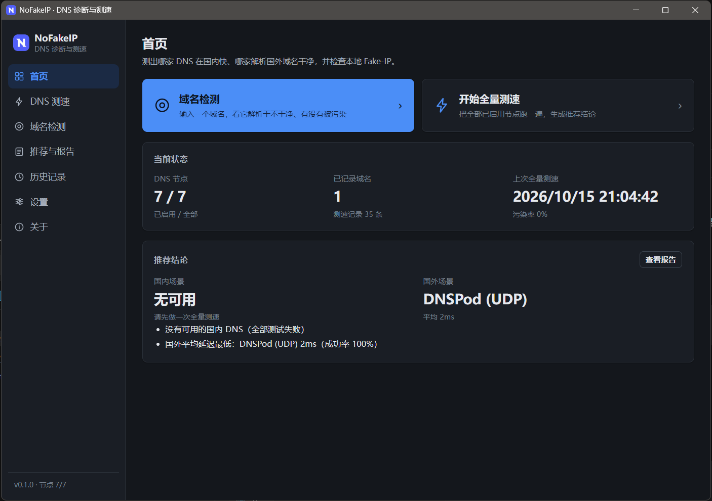
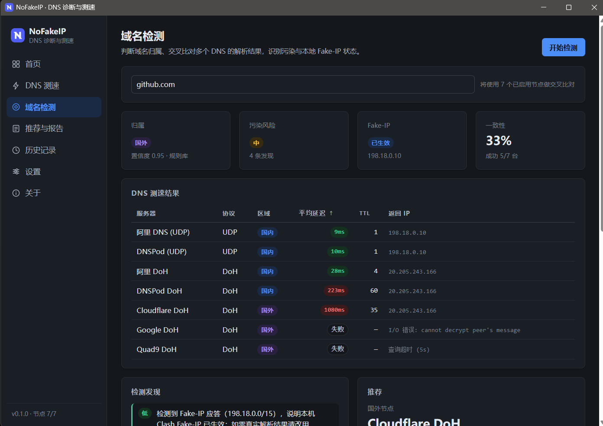
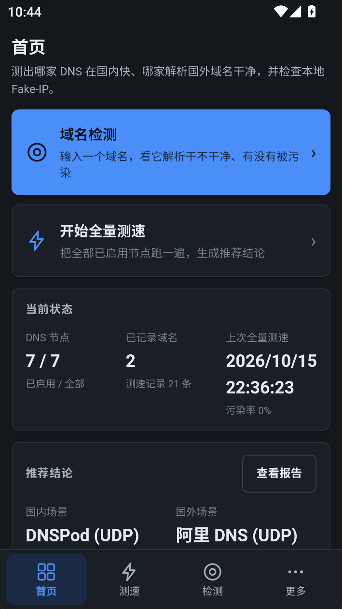
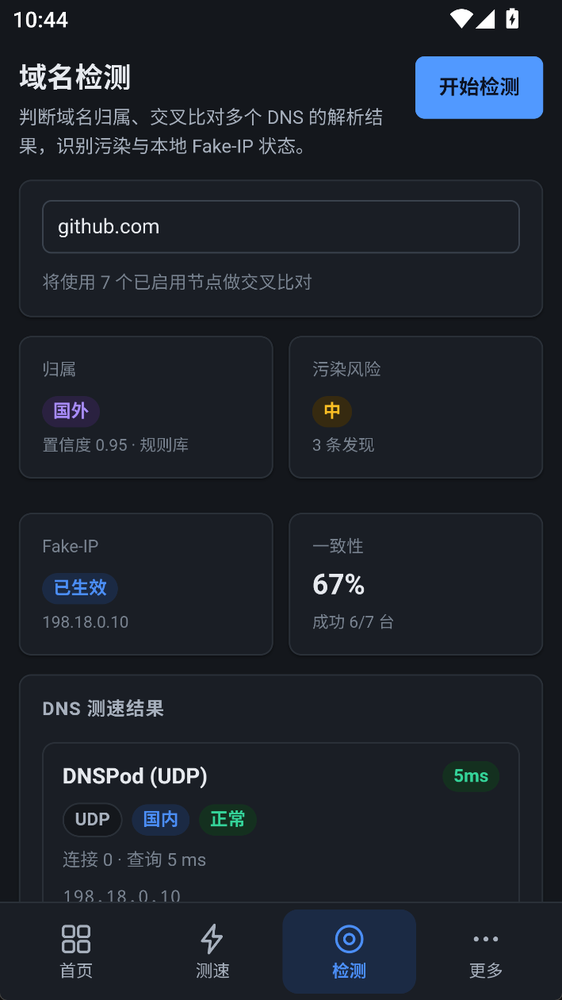

  
  <h1>NoFakeIP</h1>
  
DNS 诊断与测速工具 —— 测出哪家 DNS 在国内快、哪家解析国外域名干净

  
<b>支持桌面版（Windows / Linux）与移动版（Android），同一套功能，界面各自适配。</b>

支持 UDP / TCP / DoT / DoH 四种传输，交叉比对多个节点对同一域名的解析结果，识别 DNS 污染与本地 Fake-IP 状态，并给出可读的诊断报告。

  

  
  

  
  
  
  

## 平台支持

**桌面版与移动版功能一致**，都是完整的客户端，不是简化版或配套工具。两端共用同一套 Rust 测速引擎与前端代码，只是界面按屏幕宽度自适应：桌面端用侧栏 7 项直达，手机端用底栏 4 项 +「更多」页收纳。

| 平台 | 版本 | 说明 |
|---|---|---|
| Windows 10 / 11 | 桌面版 | 提供安装包与便携版（免安装） |
| Linux | 桌面版 | AppImage，添加执行权限后即可运行 |
| Android 7.0+ | 移动版 | arm64 APK，直接安装 |

> 竖屏手机与横屏电脑上的界面布局各不相同，但能做的操作完全一样。

## 项目简介

使用 DNS 时经常遇到这些问题：更换了「更快的」DNS 之后，访问部分网站依然缓慢；某些域名解析出的地址明显异常；路由器开启 Fake-IP 之后，难以区分真实解析结果与被本地劫持的结果。

NoFakeIP 的解决思路很明确：**让多个 DNS 节点同时解析同一个域名，并横向比较全部结果**。各节点的速度、清洁度与污染状态一目了然。

主要功能：

- **DNS 测速**：UDP / TCP / DoT / DoH 四种传输，拆分连接、TLS、查询三段耗时，定位真正的性能瓶颈。
- **域名检测**：交叉比对多个节点的解析结果，识别归属、污染风险、Fake-IP 状态与结果一致性。
- **Fake-IP 识别**：自动识别 `198.18.0.0/15` 之类的伪造地址，提示改用 DoH / DoT 获取真实结果。
- **推荐结论**：分别给出国内、国外场景下最合适的 DNS 节点，并说明理由。
- **诊断报告**：导出 Markdown / JSON / CSV，便于留存或分享。
- **历史记录**：每次结果存入本地 SQLite，随时回看某个域名的变化趋势。
- **离线可用**：内置规则库（约 11 万国内域名 / 2 万国外域名 / 7456 条中国 IP 网段）已编译进程序，首次运行无需联网下载。

## 界面预览

  

  

  
  &nbsp;&nbsp;
  

## 下载与安装

前往 [Releases](../../releases/latest) 下载对应平台的发行版本。

| 平台 | 版本 | 发行文件 | 安装方式 |
|---|---|---|---|
| Windows | 桌面版 | `NoFakeIP_<版本>_x64-setup.exe` | 运行安装程序，无需管理员权限 |
| Windows | 桌面版 | `NoFakeIP_<版本>_windows-portable.exe` | 便携版，双击即用，无需安装 |
| Android | 移动版 | `NoFakeIP_<版本>_arm64.apk` | 直接安装（需允许「安装未知来源应用」） |
| Linux | 桌面版 | `NoFakeIP_<版本>_amd64.AppImage` | 添加执行权限后运行 |
| Windows / Linux | CLI | `nofakeip-cli_<版本>_*.zip` / `.tar.gz` | 命令行版本，解压即用 |

**系统要求**：Windows 10 / 11 x64 或受支持的 Linux 发行版；Android 7.0 及以上（arm64）。

Windows 桌面版依赖系统自带的 WebView2 运行时（Win11 与较新的 Win10 已内置；若缺失，安装包会自动引导安装）。

> **未做代码签名**：Windows SmartScreen 可能提示「未知发布者」，选择「仍要运行」即可；APK 使用自签名证书，仅供安装测试。

详细说明参见 [安装与运行](../../wiki/安装与运行)。

## 使用方法

1. **查看首页**：了解当前环境状态，以及上次测速的结果。
2. **开始全量测速**：遍历已启用的节点，得到每个节点的延迟与可用性。
3. **执行域名检测**：输入一个域名（如 `github.com`），查看解析结果是否干净、是否被污染。
4. **查看推荐结论**：直接采用工具给出的国内 / 国外场景推荐节点。
5. **导出报告**：需要留档或分享时，生成 Markdown / JSON / CSV。

完整操作说明参见 [使用手册](../../wiki/使用手册)。

## 它不做什么

- **不生成、不修改任何代理软件的配置。** 只做测量与判断，输出诊断报告。
- **不在线收集你的数据。** 查询由本机发出，历史记录只存在本地数据库。
- **在线 IP 归属查询默认关闭。** 需要时可在设置里开启（走 `ip-api.com`）。

## 常见问题

**Q：测出来的延迟很低，但上网还是很慢？**
DNS 只是访问链路的一环。本工具测的是「解析这一步」的快慢，测不出后续连接质量。

**Q：为什么有些节点显示「失败」？**
通常是当前网络不可达（比如部分境外 DNS 被拦截）。这属于网络环境限制，不是程序问题。

**Q：明文 DNS 的结果明显不对？**
如果本机或路由器开了 Fake-IP 模式，UDP / TCP 查询会被本地劫持。程序会识别并提示，此时应以 DoH / DoT 的结果为准。

**Q：为什么有些域名显示「未知」？**
内置规则库覆盖有限，长尾域名可能无法判定。可在设置中更新规则数据。

更多问题参见 [常见问题](../../wiki/常见问题)。

## 技术栈

项目分为 **Rust Core**（无 GUI 依赖的引擎与 CLI）与 **Tauri 2 + React 19** 的桌面版 / 移动版客户端，两者共用同一套前端。

- **Core**：DNS 协议实现（四传输）、测速引擎、分类与污染检测、推荐引擎、报告生成、SQLite 存储。
- **CLI**：`scan` / `bench` / `classify` / `detect` / `report` / `data` / `dns` / `history` / `doctor` 九个子命令。
- **GUI**：桌面版与移动版共用 7 个页面，深浅色主题，窄屏自适应（底栏 4 项 + 「更多」页）。

从源码构建、项目结构、测试与技术实现参见 [开发指南](../../wiki/开发指南)。

## 文档

详细内容收录于 Wiki，README 仅保留快速上手所需的信息。

| 页面 | 内容说明 |
|---|---|
| [安装与运行](../../wiki/安装与运行) | 发行文件选择、安装方法与故障排查 |
| [使用手册](../../wiki/使用手册) | 各页面与控件的功能说明 |
| [DNS 测速原理](../../wiki/DNS测速原理) | 四种传输、分段耗时、延迟口径 |
| [域名检测与污染判定](../../wiki/域名检测与污染判定) | 归属、污染、Fake-IP 的判定方法 |
| [常见问题](../../wiki/常见问题) | 报错与结果异常的排查入口 |
| [开发指南](../../wiki/开发指南) | 从源码构建、项目结构、测试、Rust Core 接口 |

从 [Wiki 首页](../../wiki) 进入可以看到全部页面。

## 许可证

本项目采用 [PolyForm Noncommercial 1.0.0](LICENSE) 许可证。

允许在许可证规定的**非商业**范围内使用、修改和分发本项目。商业用途需要取得额外授权。

完整许可条款参见 [LICENSE](LICENSE)。
